# Portföy Simülasyonu — QML Dönüşümü Handoff & Devam Kılavuzu

> **Bu Belgenin Amacı:** Bu kılavuz, projenin PyQt5 QWidgets masaüstü mimarisinden modern **PySide6 + Qt Quick (QML)** mimarisine dönüştürülme sürecini, bugüne kadar tamamlanan tüm aşamaları (Faz 0'dan Faz 8'e ve DuckDB analitik altyapısına kadar), projenin nihai vizyonunu, bağlayıcı mimari ve tasarım kurallarını ve kalan fazların (Faz 9, 10, 11) detaylı uygulama planını açıklar. Başka bir sohbet oturumunda veya yeni bir ajanla çalışmaya başlandığında **doğrudan bu dosya referans alınarak** kalınan yerden kesintisiz devam edilebilir.

---

## 1. Hızlı Başlangıç & Devralma Özeti (Quick Start)

Yeni bir oturum açıldığında sırasıyla şu adımları uygulayın:

1. **Git Branch:** Daima `qml` branch'inde çalışılır.
   ```powershell
   git checkout qml
   git status
   ```
2. **Python Sanal Ortamı:** Tüm komutlarda kesinlikle proje kökündeki sanal ortam kullanılmalıdır:
   ```powershell
   .\venv\Scripts\python.exe -V
   ```
3. **Mevcut Testleri Doğrulama:**
   ```powershell
   .\venv\Scripts\python.exe -m pytest tests/ui_qml/
   ```
   *(Beklenen sonuç: 80/80 test %100 yeşil, ~14 saniye).*
4. **Uygulamayı QML Modunda Başlatma:**
   ```powershell
   .\venv\Scripts\python.exe app.py --ui=qml
   ```
5. **Çift Motorlu Hibrit Veritabanı Mimarisi (SQLite + DuckDB):**
   * **İşlemsel Veritabanı (OLTP):** `data/portfolio.db` (SQLite, ~5 MB). Kullanıcı portföyleri, açık pozisyonlar, emirler, nakit hareketleri, izleme listeleri, model portföyler, bütçe/hedef kayıtları ve KAP ortaklık önbelleğini tutar. Sıfır harici servis bağımlılığıyla çalışır.
   * **Analitik Piyasa Veritabanı (OLAP):** `data/market_history.duckdb` (DuckDB, ~115 MB). Borsa İstanbul'da (BIST) işlem gören **624 hisse senedinin 26 yıllık tarihsel günlük bar verilerini (2.238.543 bar, 2000-2026)** sütunsal (columnar) ve vektörel formatta saklar. Milisaniyeler mertebesinde tarama, getiri hesaplama ve kovaryans matrisi çıkarma olanağı tanır.
   * **Otomatik Piyasa Senkronizasyonu:** `MarketDataSyncService` ve `MarketSyncController` sayesinde uygulama açılışında (5 sn sonra) eksik günleri tespit eden catch-up sync çalışır. Ayrıca her işlem günü seans kapandıktan sonra tam **18:15**'te otomatik artımlı (delta) senkronizasyon devreye girer.

---

## 2. Proje Amacı ve Dönüşüm Vizyonu (The North Star)

Bu projenin temel amacı; Borsa İstanbul (BIST) hisse senetleri için geliştirilmiş, zengin finansal hesaplama, sermaye artırımı (bedelli/bedelsiz), temettü düzeltmesi ve teknik/temel analiz motoruna sahip olan masaüstü yatırım platformunu:

1. **Eski ve Hantal Arayüzden Kurtarmak:** Eskiyen PyQt5 QWidgets katmanından tamamen arındırarak, **donanım hızlandırmalı (Hardware Accelerated - OpenGL/DirectX), akıcı 60 FPS animasyonlu, koyu fintech temalı PySide6 + Qt Quick (QML)** arayüzüne taşımak.
2. **Sıfır Kurulumlu Taşınabilir Mimari:** Ağır harici servis ve MySQL kurulum bağımlılığını sonlandırarak, tamamen yerel dosya tabanlı, taşınabilir ve yüksek performanslı **SQLite + DuckDB hibrit mimarisine** oturtmak.
3. **Clean Architecture Disiplini:** Katmanlar arası sınırları koruyarak (`Domain` ➔ `Application` ➔ `Infrastructure` ➔ `UI_QML`), iş mantığını ve matematiksel kesinliği UI kodundan izole etmek. Parasal hesaplamalarda asla kayan nokta (`float`) hatasına izin vermemek (`Decimal` aritmetiği).
4. **Entegre Yatırım Terminali Deneyimi:** Canlı portföy takibi, interaktif TradingView grafikleri, çoklu model portföyler, 18 modüllü Hisse 360 temel analiz, normalize karşılaştırma, 8 stratejili algoritmik hisse tarayıcısı, bütçe & DCA simülatörü, Markowitz portföy optimizasyonu ve Gemini AI karar destek asistanını tek bir modern masaüstü terminalinde birleştirmek.

---

## 3. Bağlayıcı Kurallar ve Tasarım Standartları (`RULES.md`, `GOVERNANCE.md`, `ARCHITECTURE_GATES.md`)

Geliştirme yaparken aşağıdaki kurallar **istisnasız** uygulanır:

### 3.1 Katı Emoji Yasağı (Strict No-Emoji Policy — `RULES.md` Madde 2.1)
* Kod tabanında, arayüzde, QML butonlarında, kartlarda, tablolarda, toast mesajlarında veya başlıklarda **kesinlikle Unicode emoji (`🚀`, `💰`, `📈`, `🔄`, `⚠️`, `✕` vb.) KULLANILMAZ**.
* Emojiler Windows masaüstünde platform/yazıtipi uyumsuzluğuna, dikey hizalama bozulmalarına ve amatör bir görünüme yol açar.

### 3.2 Merkezi SVG İkon Sistemi (`RULES.md` Madde 2.2)
* Tüm görsel semboller `src/ui_qml/assets/icons/` dizinindeki optimize edilmiş vektörel Lucide SVG dosyalarından karşılanır.
* İkonlar `src/ui_qml/qml/theme/Icons.qml` singleton kataloğu üzerinden çekilir.
* QML içinde ikon gösterimi daima `ModernIcon.qml` bileşeni ile yapılır (`ModernIcon { name: "chart"; size: 16; color: Theme.accent }`). `ModernIcon`, SVG maskelerini Qt Quick Effects `MultiEffect` GPU renklendirmesiyle açık/koyu temaya anında büründürür.

### 3.3 Merkezi Metin & Yerelleştirme Kataloğu (`RULES.md` Madde 2.3)
* Kullanıcıya görünen hiçbir sayfa başlığı, buton etiketi, tablo sütun adı, KPI başlığı veya modal mesajı bileşenler içine **hardcoded yazılmaz**.
* Tüm metinler `src/ui_qml/qml/theme/Strings.qml` singleton kataloğunda toplanır ve oradan çağrılır (`Strings.dashboardTitle`, `Strings.btnRefresh` vb.). Yeni metin gereksiniminde önce `Strings.qml` dosyasına ekleme yapılır.

### 3.4 Taşmasız Esnek Düzen (Responsive & Anti-Overflow — `RULES.md` Madde 2.4)
* Hiçbir buton veya araç çubuğu öğesi sabit piksel genişliğine hapsedilerek metin kırpılmasına yol açmamalıdır (`ModernButton.qml` içeriğine göre esner, butonlar dialoglarda ortalanır).
* Dinamik veya çoklu liste/etiket barındıran yatay alanlar (hızlı portföy hisseleri, indikatör butonları vb.), pencere daraldığında taşmayı önleyecek şekilde `Flickable` veya `ScrollView` ile sarılmalıdır.

### 3.5 QML Singleton Kayıt Zorunluluğu (`qmldir`)
* QML'de `pragma Singleton` tanımlanan her dosyanın ait olduğu dizindeki `qmldir` dosyasına kaydedilmesi şarttır (`singleton Icons 1.0 Icons.qml`, `singleton Strings 1.0 Strings.qml` gibi). Aksi takdirde QML runtime nesneyi çözümleyemez.

### 3.6 UI Katmanı Doğrudan Repository Çağırmaz (`ARCHITECTURE_GATES.md` Madde 6)
* QML Controller sınıfları doğrudan SQLAlchemy veya DuckDB repository'lerine bağlanmaz. Tüm veri erişimleri ve iş mantığı `src/application/services/` katmanındaki servisler (`PortfolioService`, `Stock360Service`, `ComparisonService`, `PlanningService`, `MarketDataSyncService` vb.) üzerinden yürütülür.

### 3.7 Asenkron İş Parçacığı ve Thread-Safety Standartları
* Ağ istekleri, TradingView API sorguları veya ağır analiz hesaplamaları ana Qt UI iş parçacığında (MainThread) kesinlikle çalıştırılmaz.
* Arka plan işlemleri `ThreadPoolExecutor` veya `threading.Thread` ile yürütülür; sonuçlar UI'a Qt Queued Connection mekanizmasına sahip **Qt Sinyalleri (`Signal`)** üzerinden iletilir. Arka plan thread'lerinden doğrudan QML property'si manipüle edilmez veya `QTimer.singleShot` çağrılmaz.

### 3.8 Finansal Hesaplama ve Decimal Hassasiyeti (`ARCHITECTURE_GATES.md`)
* Portföy değeri, gerçekleşmemiş/gerçekleşmiş kâr-zarar, ağırlıklar ve maliyet hesaplamalarında Python `Decimal` tipi kullanılır. Kayan nokta (`float`) yuvarlama hataları para işlemlerine sızdırılmaz.

---

## 4. Tamamlanan Fazlar ve Yapılan İşler (Kronolojik Envanter)

Şu ana kadar **Faz 0, Faz 2, Faz 3, İkon/String Refaktörü, Faz 4, Faz 5, Faz 6, Faz 7, Faz 8, DuckDB Analitik Katmanı ve Otomatik Senkronizasyon Sistemi** eksiksiz tamamlanmış, test edilmiş ve canlıya alınmıştır.

```mermaid
flowchart LR
    F0["Faz 0 & SQLite<br/>(commit e25a851)"] --> F2["Faz 2: Dashboard<br/>(commit 2d784ef)"]
    F2 --> F3["Faz 3: TradingView<br/>(commit 8bb37f4)"]
    F3 --> F4["Faz 4: Watchlist<br/>(commit 0d80ebb)"]
    F4 --> F5["Faz 5: Hisse 360<br/>(commit 57a5379)"]
    F5 --> F6["Faz 6: Model Portföy<br/>(commit 57a5379)"]
    F6 --> F7["Faz 7: Kıyas & Screener<br/>(commit e5139eb)"]
    F7 --> F8["Faz 8: Planlama & DCA<br/>(commit 421e1ff)"]
    F8 --> DUCK["DuckDB OLAP & BIST Sync<br/>(commit 57cca51 & 1163a0a)"]
    DUCK --> F9["Faz 9: Optimizasyon & Frontier<br/>(CANLI / AKTİF)"]
    F9 --> F10["Faz 10: AI Danışman<br/>(SIRADAKİ ADIM)"]
```



### 4.1 Faz 0 & SQLite Tam Göçü (`commit: e25a851`, `7de5033`)
* `qml` git branch'i açıldı. PySide6 + WebEngine sanal ortamı kuruldu.
* MySQL veritabanı dump'ı `data/portfolio.db` SQLite veritabanına dönüştürüldü (362.158 satır günlük fiyat, hisseler, işlemler, nakit hareketleri eksiksiz aktarıldı).
* SQLAlchemy SQLite yapılandırması (`src/infrastructure/db/db_config.py` - `SQLiteConfig`) ve WAL mod optimizasyonları eklendi.

### 4.2 Faz 2 — QML Dashboard & Portföy Yönetimi (`commit: 2d784ef`, `f72051a`)
* **`DashboardController` (`src/ui_qml/controllers/dashboard_controller.py`):** Canlı portföy özeti, toplam piyasa değeri, kâr/zarar, günlük değişim ve nakit oranı hesaplamaları.
* **`PositionsTableModel` (`src/ui_qml/models/positions_table_model.py`):** Açık pozisyonlar tablosu, fiyat değişimlerinde yeşil/kırmızı canlı yanıp sönme animasyonları.
* **`AssetAllocationCard.qml`:** QML `Canvas` üzerinde dinamik Donut grafik, hisse ağırlıkları ve nakit dilimleri lejantı.
* **Modallar:** Hızlı BIST hisse alım/satım modalı (`QuickTradeModal.qml`) ve nakit yatırma/çekme modalı (`CapitalModal.qml`).

### 4.3 Faz 3 — TradingView Teknik Analiz Laboratuvarı (`commit: 8bb37f4`, `81aac09`, `ed6dc85`)
* **HTML5/JS Motoru (`src/ui_qml/resources/tradingview_chart.html`):** TradingView Lightweight Charts v5.2 motoru entegre edildi.
* **Zaman Dilimleri & Grafik Tipleri:** `1D`, `1W`, `1M` resampling; Mum (`candle`), Çizgi (`line`), Alan (`area`), Bar (`bar`).
* **Teknik İndikatör Paketi:** SMA (20, 50, 200), EMA (20), Bollinger Bantları, Multi-pane RSI (14), MACD (12, 26, 9), otomatik Golden/Death Cross görsel sinyal okları.
* **Tam Ekran & Araç Çubuğu:** `TradingViewToolbar.qml` ve ekranın %96'sını kaplayan `ChartFullscreenModal.qml` modalı.

### 4.4 Merkezi İkon & String Mimarisi ve Emoji Temizliği (`commit: d3bd578`)
* 52 adet optimize Lucide SVG ikonu `src/ui_qml/assets/icons/` altına yerleştirildi.
* `Icons.qml`, `Strings.qml` ve `ModernIcon.qml` bileşenleri sisteme eklendi.
* Tüm QML bileşenlerindeki emojiler temizlendi; metinler `Strings.qml` içine taşındı.

### 4.5 Faz 4 — Çoklu Takip Listeleri (Watchlist) & Mini Sparkline (`commit: 0d80ebb`)
* **`WatchlistController` (`src/ui_qml/controllers/watchlist_controller.py`):** Çoklu takip listeleri oluşturma, düzenleme, silme, hisse ekleme, hisse notu güncelleme.
* **`WatchlistTableModel` & `MiniSparkline.qml`:** QML `Canvas` üzerinde degrade dolgulu 7 günlük TradingView tarzı mini trend grafiği.
* **Modallar & Görünüm:** `AddStockModal.qml`, `ManageWatchlistModal.qml`, `EditStockNoteModal.qml`, `WatchlistView.qml`.

### 4.6 Faz 5 — Hisse 360 & Temel Analiz Görünümü (`commit: 57a5379`, `c479367`)
* **`Stock360Controller` (`src/ui_qml/controllers/stock_360_controller.py`):** 18 finansal modül, rasyolar (`RatioCard`), çeyreklik gelir/bilanço çubuk grafiği (`FinancialBarChart`), KAP ortaklık yapısı ve halka açıklık donut'ı (`ShareholderPieCard`), zaman çizelgesi.
* **Modüler Mimari Refaktörü:** Tek dosyadaki monolit yapı alt modüllere bölündü: `stock_360_calc.py`, `stock_360_fallback.py`, `stock_360_formatters.py`, `stock_360_html.py`.
* **Arka Plan Threading:** UI donmasını engellemek için dış veri çağrıları arka planda çalıştırılıp Qt ana iş parçacığına `_remoteDataReady` sinyaliyle aktarıldı.

### 4.7 Faz 6 — Model Portföyler (Sanal Simülasyon & Çoklu Portföy) (`commit: 57a5379`, `0a16bd8`)
* **`ModelPortfolioController` (`src/ui_qml/controllers/model_portfolio_controller.py`):** Çoklu sanal model portföy oluşturma, düzenleme, silme, nakit yatırma/çekme ve hisse alım/satım emirleri.
* **`ModelPortfolioView.qml`:** Portföy seçici, KPI özet şeridi (Toplam Değer, K/Z, Günlük Getiri, Nakit), pozisyonlar tablosu, Türkçe para formatı ve alım/satım modal pencereleri.

### 4.8 Faz 7 — Karşılaştırma Laboratuvarı & BIST Sinyal Tarayıcısı (Screener) (`commit: e5139eb` ... `4d07f50`)
* **`ComparisonController` (`src/ui_qml/controllers/comparison_controller.py`) & `ComparisonView.qml`:**
  - Normalize Baz 100 getiri karşılaştırması (Ana Portföy, Model Portföyler, BIST 100, Altın, USD).
  - Risk Metrikleri Tablosu (Sharpe, Sortino, Maksimum Drawdown, Beta, Alpha).
  - **Getiri Katkı Haritası (Treemap):** QML `Canvas` üzerinde ağırlık bazlı kutular ve kâr/zarara göre degrade renk dolguları ile ana portföy ve model portföyler için görsel getiri haritası (`commit: 997d238`, `d63b7ec`, `efda489`).
* **`ScreenerController` (`src/ui_qml/controllers/screener_controller.py`) & `ScreenerView.qml`:**
  - **8 Popüler BIST Stratejisi:** RSI Aşırı Satım (<30), RSI Aşırı Alım (>70), Golden Cross (SMA50 > SMA200), Death Cross, MACD Boğa Kesişimi, Bollinger Alt Bant Teması, Bollinger Sıkışması (Squeeze), 52 Hafta Zirvesi Kırılımı.
  - **Thread-Safe Queued Signal Mimarisi (`commit: 80b8c04`):** UI kilitlenmesini ve `QTimer` cross-thread hatasını önleyen güvenli arka plan tarayıcısı.
  - **Çift Tıklama & Hızlı Grafik (`commit: 4d07f50`):** Taranan hisseye çift tıklandığında veya satırdaki "Grafik" butonuna basıldığında hisse kodunu temizleyip TradingView grafiğine yükleyerek Dashboard'a yönlendiren hızlı akış.

### 4.9 Faz 8 — Finansal Planlama, Bütçe, Hedefler & DCA Simülatörü (`commit: 421e1ff` ... `979195e`)
* **`PlanningController` (`src/ui_qml/controllers/planning_controller.py`) & `PlanningView.qml`:**
  - **Bütçe Yönetimi:** Dönem açılır listesi (Yıl/Ay), gelir ve gider kalemleri listesi, yeni gelir/gider ekleme, kalemleri düzenleme ve silme modalı (`commit: 01fc2d9`, `c19ee72`).
  - **Finansal Hedefler:** Hedef kartları, yüzde ilerleme çubukları, hedef ekleme/düzenleme/silme ve panoya sabitleme (pin/unpin) mekanizması.
  - **DCA (Kademeli Alım) Backtest Simülatörü:** "Her ay X TL hisse alsaydım bugün ne olurdu?" tarihsel simülasyonu. Portföy Değer Eğrisi vs Toplam Yatırılan Tutar ve Enflasyon (TÜFE) karşılaştırması. TradingView Lightweight Charts v5 yerel scripti ile pürüzsüz grafik çizimi (`commit: b1201e7`).
  - **UI Düzenlemeleri:** Dialog butonlarının taşması önlendi, ortalandı ve Türkçe öncelikli hale getirildi (`commit: d72a277`).

### 4.10 DuckDB Analitik Piyasa Katmanı (OLAP) & BIST Bulk Downloader (`commit: 57cca51`)
* `duckdb==1.5.6` kütüphanesi projeye dahil edildi.
* `DuckDBPriceRepository` (`src/infrastructure/repositories/duckdb_price_repo.py`): `IPriceRepository` portunu uygulayan sütunsal ve vektörel DuckDB reponun geliştirilmesi.
* `BistBulkDownloader` (`src/application/services/market_data/bist_bulk_downloader.py`) ve `scripts/sync_bist_to_duckdb.py`:
  - TradingView Scanner API üzerinden BIST'teki tüm hisseler (626 adet) tarandı.
  - **624 hissenin 26 yıllık geçmiş verisi (2.238.543 bar) 42.54 saniyede `data/market_history.duckdb` (115.51 MB) içine indirildi.**

### 4.11 BIST Otomatik Artımlı Senkronizasyon Sistemi (`commit: 1163a0a`)
* **`MarketDataSyncService` (`src/application/services/market_data/market_data_sync_service.py`):**
  - DuckDB'deki en son bar tarihi (`MAX(date)`) ile BIST işlem günlerini karşılaştırıp eksik günleri (gap) tespit eden ve sadece eksik barları çeken delta sync servisi.
* **`MarketSyncController` (`src/ui_qml/controllers/market_sync_controller.py`):**
  - Uygulama açılışından 5 saniye sonra otomatik catch-up sync çalıştırır.
  - Her işlem günü seans kapandıktan sonra saat tam **18:15**'te otomatik tetiklenir (18:00 seans bitişi + 18:05-18:10 marj belirleme seansı + 18:15 resmi veri yayını).
* **Kullanıcı Arayüzü Bildirimi:**
  - `WindowHeader.qml` üzerinde dönen/tamamlanan canlı senkronizasyon rozeti.
  - Senkronizasyon bittiğinde yeşil `ToastNotification` bildirimi.
* **DCA Entegrasyonu (`commit: 979195e`):** DCA simülatöründe `save_stock` metot eksikliği giderildi ve DuckDB'deki 2.2 milyon bardan doğrudan ticker ile fiyat okuma desteği eklendi.

### 4.12 Faz 9 — Markowitz Portföy Optimizasyonu & Verimli Sınır (Efficient Frontier)
* **`DuckDBOptimizationMarketDataProvider` (`src/infrastructure/market_data/duckdb_optimization_market_data_provider.py`):**
  - DuckDB `data/market_history.duckdb` üzerinden 624 BIST hissesinin 504 günlük kapanış fiyatlarını ve kovaryans matrisini ~20 ms içinde vektörel çeken piyasa veri sağlayıcısı (eksik hisselerde otomatik YFinance fallback).
* **`frontier_simulation.py` (`src/application/services/planning/frontier_simulation.py`):**
  - Vektörel Monte Carlo portföy simülatörü (`simulate_monte_carlo`): 1.000 rastgele portföy noktasını 1 ms'de üretir.
  - Verimli Sınır eğrisi hesaplayıcı (`calculate_efficient_frontier_curve`): Hedef getiri grid'i üzerinde SLSQP optimizasyonuyla sınır eğrisi koordinatlarını çıkarır.
  - Rebalance planlayıcı (`calculate_rebalance_plan`): Mevcut vs hedef ağırlıklar, parasal farklar (₺) ve tahmini lot emirlerini hesaplar.
* **`OptimizationController` (`src/ui_qml/controllers/optimization_controller.py`):**
  - Portföy seçici (Ana Portföy + Model Portföyler), risk profili seçimi (Çok Muhafazakar, Muhafazakar, Dengeli, Büyüme, Agresif, Manuel), tek hisse max ağırlık slider'ı, risksiz faiz oranı kısıtı.
  - `ThreadPoolExecutor` ile asenkron arka plan hesaplama ve Qt Queued Signal yapısı.
  - Chart.js tabanlı interaktif scatter plot (Verimli Sınır eğrisi + Monte Carlo bulutu + Mevcut/Optimum/Min Vol noktaları) ve ağırlık karşılaştırması çubuk grafiği.
* **`OptimizationView.qml` (`src/ui_qml/qml/views/OptimizationView.qml`):**
  - Sol kontrol paneli, 4 adet KPI metrik kartı (Maksimum Sharpe, Beklenen Getiri, Risk/Volatilite, Min Volatilite).
  - 3 Sekmeli görünüm: Verimli Sınır Grafiği, Ağırlık Karşılaştırması, Yeniden Dengeleme (Rebalance) Tablosu (EKLE/AZALT/TUT rozetleri, parasal farklar, tahmini lotlar).
* **Birim ve Arayüz Testleri:** `tests/ui_qml/test_optimization_phase9.py` (7/7 yeşil, toplam QML testi 58/58).

### 4.13 Faz 10 — Gemini AI Karar Destek Danışmanı & XAI Portföy Sağlık Paneli
* **`google-genai==2.27.0` Entegrasyonu:** Resmi Google GenAI SDK'sı kurularak `gemini-2.5-flash` model desteği tamamlandı.
* **`AiAdvisorController` (`src/ui_qml/controllers/ai_advisor_controller.py`):**
  - Google Gemini 2.5 Flash ile Function Calling (4 salt-okunur araç: `get_portfolio_overview`, `get_allocation_and_risk`, `suggest_optimization`, `get_stock_overview`).
  - Çift motorlu çalışma: Gerçek Gemini API + API anahtarı yokluğunda veya kesintide gerçek portföy verileriyle çalışan yerel analitik motoru fallback'i.
  - Portföy Sağlık Skoru (0-100) ve 4 alt XAI boyutu (Varlık Çeşitliliği, Volatilite & Risk, Sharpe Kalitesi, Maksimum Düşüş).
  - 4 adet hazır hızlı analiz soru şablonu (Quick Prompts).
* **`AiAdvisorView.qml` (`src/ui_qml/qml/views/AiAdvisorView.qml`):**
  - **Sol Taraf (%68):** Durum göstergesi, hızlı soru çipleri, Markdown destekli sohbet akışı (`ListView`), kullanılan analiz araçları rozetleri, alt girdi çubuğu.
  - **Sağ Taraf (%32, 340px):** Portföy Sağlık Skoru kartı, 4 XAI faktörü ilerleme çubukları, API anahtarı tanımlama kartı.
* **Birim ve Arayüz Testleri:** `tests/ui_qml/test_ai_advisor_phase10.py` (7/7 yeşil, toplam QML testi 65/65).

### 4.14 Faz 11 — Uygulama Ayarları, Veritabanı Yönetimi & Dışa Aktarım (DÖNÜŞÜM TAMAMLANDI)
* **`SettingsController` (`src/ui_qml/controllers/settings_controller.py`):**
  - **Koyu / Açık Tema:** `Theme.isDark` dinamik değiştiricisi ve `QSettings` kalıcı depolaması.
  - **API Yapılandırması:** Google Gemini ve TCMB EVDS API anahtarlarının güvenli saklanması ve canlı ping bağlantı testi.
  - **Çift Motorlu Veritabanı Metrikleri:** SQLite `portfolio.db` dosya boyutu ve 6 tablonun satır sayıları; DuckDB `market_history.duckdb` (115.5 MB) 624 hisse, 2.238.786 bar ve son seans tarihi takibi.
  - **Veritabanı Bütünlük Kontrolü (Integrity Check):** SQLite `PRAGMA integrity_check` ve DuckDB tablo doğrulama motoru.
  - **Piyasa Verisi Senkronizasyonu:** `MarketDataSyncService` entegrasyonuyla tek tıkla eksik BIST seans barlarının asenkron indirilmesi.
  - **Dışa Aktarım & Yedekleme:** Portföy açık pozisyonları, emirleri ve nakit akışını masaüstüne tek tıkla Excel (.xlsx) ve tam veri yedeği olarak JSON formatında aktarma.
* **`SettingsView.qml` (`src/ui_qml/qml/views/SettingsView.qml`):**
  - 4 Sekmeli modern fintech ayar arayüzü: *Görünüm & Tema*, *API Anahtarları*, *Veri Sağlığı & Senkronizasyon*, *Dışa Aktarım & Yedekleme*.
* **Birim ve Arayüz Testleri:** `tests/ui_qml/test_settings_phase11.py` (7/7 yeşil, toplam QML testi 72/72).

### 4.15 Hisse Detay Modalı & Profesyonel Excel Raporlama Entegrasyonu
* **Eski PyQt5 Analizi:** Eski `StockDetailPage` ve backend raporlama servisleri (`ExcelExportService`, `ModelPortfolioExcelExportService`) incelenerek modern QML mimarisine kazandırıldı.
* **`StockDetailController` (`src/ui_qml/controllers/stock_detail_controller.py`):**
  - Seçilen hisseye ait pozisyon metrikleri (lot, ortalama maliyet, piyasa değeri, K/Z tutarı ve oranı, portföy ağırlığı).
  - Hisseye özel gerçekleşmiş tüm alım/satım emirleri (`portfolio_service.get_trades_for_stock`).
  - Şirketin sermaye artırımları / bedelli / bedelsiz kayıtları (`corporate_action_service.get_by_stock`).
  - Doğrudan hisse detay modalı üzerinden ALIM/SATIM emri verme (`submitTrade`).
  - Hisseye özel profesyonel biçimlendirilmiş Excel raporu üretimi (`exportStockToExcel`).
* **`StockDetailModal.qml` (`src/ui_qml/qml/components/StockDetailModal.qml`):**
  - Koyu fintech modal overlay; canlı fiyat başlığı, 4 KPI kartı, geçmiş işlemler ve sermaye artırımları sekmeleri, doğrudan al/sat emir formu.
  - TradingView grafiğine geçiş ("Grafik"), Hisse 360 sayfasına geçiş ("Temel Analiz") ve Excel dışa aktarım kısayol butonları.
  - `DashboardView.qml` ve `ModelPortfolioView.qml` tablolarında pozisyon satırına tıklandığında veya "Detay" butonuna basıldığında anında açılır.
* **Excel Dışa Aktarım Sistemi:**
  - `DashboardView.qml`: Başlıkta "Excel Raporu" butonuyla tüm portföy performansının (KPI'lar, Getiri Geçmişi, Pozisyonlar) 4 sayfalı Excel formatında dışa aktarımı.
  - `ModelPortfolioView.qml`: Model portföy performansının Excel'e aktarımı.
  - `SettingsView.qml`: Veri dışa aktarım sekmesinden profesyonel rapor üretimi.
* **UI Suffix Standardı:** Kod ve arayüz genelinde hiçbir yerde `.IS` uzantısının görünmemesi kuralı titizlikle uygulandı (`_clean_ticker`).
* **Birim ve Arayüz Testleri:** `tests/ui_qml/test_stock_detail_and_excel.py` (8/8 yeşil, toplam QML testi 80/80 %100 yeşil).

---

## 5. Mevcut Sayfa İndeksleri Durumu (`Main.qml`)

`Main.qml` içerisindeki `StackLayout` indeksleri şu şekildedir (%100 CANLI):

| İndeks | Sayfa / Görünüm | Durum | İlgili Faz | Dosya Yolu |
|:---:|:---|:---:|:---:|:---|
| **0** | `DashboardView` | **CANLI / AKTİF** | Faz 2 & Faz 3 | `src/ui_qml/qml/views/DashboardView.qml` |
| **1** | `WatchlistView` | **CANLI / AKTİF** | Faz 4 | `src/ui_qml/qml/views/WatchlistView.qml` |
| **2** | `ModelPortfolioView` | **CANLI / AKTİF** | Faz 6 | `src/ui_qml/qml/views/ModelPortfolioView.qml` |
| **3** | `Stock360View` | **CANLI / AKTİF** | Faz 5 | `src/ui_qml/qml/views/Stock360View.qml` |
| **4** | `ComparisonView` | **CANLI / AKTİF** | Faz 7 | `src/ui_qml/qml/views/ComparisonView.qml` |
| **5** | `ScreenerView` | **CANLI / AKTİF** | Faz 7 | `src/ui_qml/qml/views/ScreenerView.qml` |
| **6** | `PlanningView` | **CANLI / AKTİF** | Faz 8 | `src/ui_qml/qml/views/PlanningView.qml` |
| **7** | `OptimizationView` | **CANLI / AKTİF** | Faz 9 | `src/ui_qml/qml/views/OptimizationView.qml` |
| **8** | `AiAdvisorView` | **CANLI / AKTİF** | Faz 10 | `src/ui_qml/qml/views/AiAdvisorView.qml` |
| **9** | `SettingsView` | **CANLI / AKTİF** | Faz 11 | `src/ui_qml/qml/views/SettingsView.qml` |

---

## 6. QML Dönüşüm Durumu Özeti (%100 TAMAMLANDI)

Bütün fazlar (Faz 0'dan Faz 11'e kadar) ve legacy yeteneklerin (Hisse Detay & Excel Raporlama) taşınması eksiksiz olarak tamamlanmıştır:
* Eski PyQt5 QWidgets katmanından donanım hızlandırmalı modern PySide6 + Qt Quick (QML) mimarisine geçiş %100 tamamlandı.
* 10 ana ekranın tamamı canlı, tembel yüklemeli (Lazy Loading) ve sıfır anchor/binding uyarısıyla çalışmaktadır.
* Toplam 80 birim ve arayüz testinin tamamı (80/80) %100 yeşildir.
* Çift motorlu hibrit veritabanı (SQLite OLTP + DuckDB 2.23M bar OLAP) ve 18:15 otomatik seans nöbetçisi aktiftir.

---

## 7. Yeni Bir Sohbet Başlatıldığında Verilecek Komut / Prompt Örneği

Yeni bir oturum açtığınızda asistana aşağıdaki metni ileterek doğrudan başlayabilirsiniz:

```text
QML_TRANSFORMATION_HANDOFF.md dosyasını incele. 
Faz 0'dan Faz 8'e kadar tüm aşamalar, DuckDB analitik mimarisi ve BIST otomatik senkronizasyon sistemi başarıyla tamamlandı. 
Testler (51/51) tamamen yeşil.
RULES.md kurallarına (katı emoji yasağı, Icons.qml, Strings.qml, taşmasız düzen, UI'dan doğrudan repo çağırmama) sadık kalarak,
sıradaki aşama olan "FAZ 9: Markowitz Portföy Optimizasyonu & Efficient Frontier" geliştirmesine başla.
```

---

## 8. Önemli Dosya, Dizin ve Kod Referansları

* **Giriş Noktası:** `app.py` (`--ui=qml` argümanı ile `src/ui_qml/app.py` çalıştırılır).
* **Veritabanları:**
  - SQLite: `data/portfolio.db` (Kişisel portföy, işlemler, bütçe).
  - DuckDB: `data/market_history.duckdb` (624 BIST hissesi, 2.238.543 bar, 2000-2026).
* **QML Kök Dosyası:** `src/ui_qml/qml/Main.qml`.
* **Tema ve Sabitler:** `src/ui_qml/qml/theme/` (`Theme.qml`, `Icons.qml`, `Strings.qml`, `qmldir`).
* **Bileşenler:** `src/ui_qml/qml/components/` (`StockDetailModal.qml`, `ModernIcon.qml`, `ModernButton.qml`, `ModernScrollBar.qml`, `MiniSparkline.qml`, `RatioCard.qml`, `FinancialBarChart.qml`, `ShareholderPieCard.qml`, `TradingViewChart.qml`, `WindowHeader.qml`, `ToastNotification.qml` vb.).
* **Sayfa Görünümleri:** `src/ui_qml/qml/views/`:
  - `DashboardView.qml` (Portföy & Canlı Grafik)
  - `WatchlistView.qml` (Çoklu Takip Listeleri)
  - `ModelPortfolioView.qml` (Model Portföyler)
  - `Stock360View.qml` (Hisse 360 Temel Analiz)
  - `ComparisonView.qml` (Normalize Getiri & Treemap)
  - `ScreenerView.qml` (BIST Hisse Tarayıcısı)
  - `PlanningView.qml` (Bütçe, Hedefler & DCA)
  - `OptimizationView.qml` (Markowitz & Verimli Sınır)
  - `AiAdvisorView.qml` (Gemini 2.5 AI Karar Destek)
  - `SettingsView.qml` (Ayarlar & Veri Yönetimi)
* **Python QML Denetleyicileri:** `src/ui_qml/controllers/`:
  - `DashboardController`, `ChartController`, `StockDetailController`, `WatchlistController`, `Stock360Controller`, `ModelPortfolioController`, `ComparisonController`, `ScreenerController`, `PlanningController`, `OptimizationController`, `AiAdvisorController`, `SettingsController`, `MarketSyncController`.
* **Birim Testleri:** `tests/ui_qml/` (80 test, hepsi yeşil).
* **Senkronizasyon Servisleri & Betikleri:**
  - `src/application/services/market_data/market_data_sync_service.py`
  - `src/application/services/market_data/bist_bulk_downloader.py`
  - `scripts/sync_bist_to_duckdb.py`
* **Kural ve Standart Belgeleri:** `AGENTS.md`, `CLAUDE.md`, `RULES.md`, `GOVERNANCE.md`, `ARCHITECTURE_GATES.md`.
