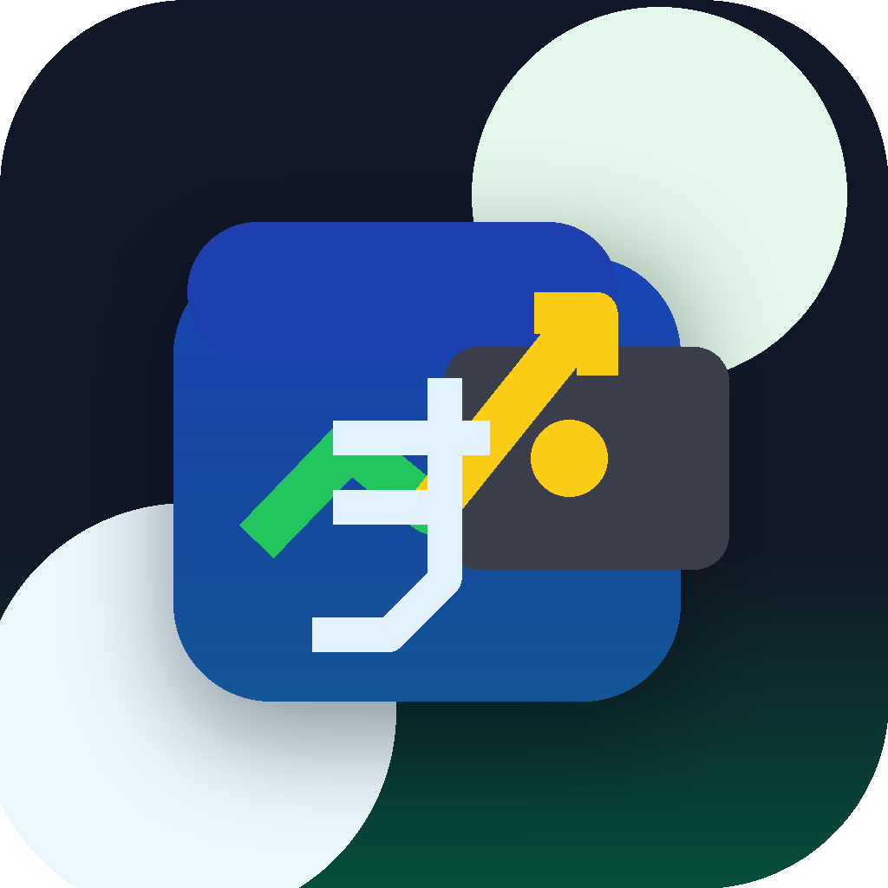
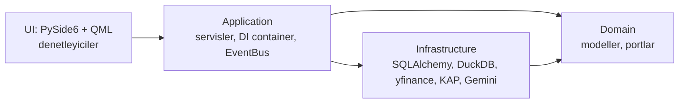

# Portföy Simülasyonu

<p align="center">
  
</p>

<h3 align="center">BIST ve küresel hisseler için portföy takibi, tüm BIST taraması, optimizasyon, backtest ve AI destekli analiz sunan masaüstü yatırım platformu</h3>

<p align="center">
  
  
  
  
  
  
</p>

---

## Genel Bakış

Portföy Simülasyonu, portföy işlemlerini, piyasa verisini, analizi ve planlamayı tek bir yerel masaüstü uygulamada birleştirir. Harici sunucu gerekmez: işlemsel veriler SQLite'ta, tüm BIST'in 26 yıllık günlük verisi DuckDB'dedir. Arayüz GPU hızlandırmalı, koyu/açık temalı **PySide6 + QML (Qt Quick)** arayüzüdür.

Üretilen analizler, optimizasyon çıktıları, backtest sonuçları ve yapay zekâ yorumları **karar desteğidir**, yatırım tavsiyesi değildir; nihai karar kullanıcıya aittir.

## Özellikler

| Sayfa | Yetenekler |
|---|---|
| **Genel Bakış** | Canlı portföy KPI'ları, pozisyonlar, varlık dağılımı, TradingView grafiği (göstergeler, tam ekran), hızlı alım/satım, sermaye yatırma/çekme, kapanış fiyatı güncelleme, haftalık/aylık getiri, tarihsel Excel raporu. Hisse detayında sermaye artırımı (bedelli/bedelsiz) ve **nakit temettü** kaydı. |
| **İzleme Listeleri** | Çoklu liste, sürükle-bırak sıralama, kod doğrulama, mini sparkline, notlar. |
| **Model Portföyler** | Sanal portföyler: sermaye hareketleri, işlem, canlı fiyat, Excel raporu. |
| **Hisse 360** | Fiyat ve teknik seviyeler, çeyreklik mali tablolar, rasyolar, DuPont, nakit akışı, KAP ortaklık yapısı. |
| **Karşılaştırma Lab** | Portföy, model portföy, BIST 100, altın, gümüş, USD/EUR, mevduat, TÜFE ve hisseleri normal/baz 100/rasyo modunda, TL/USD/reel cinsten kıyaslama; drawdown, aylık getiri, risk-getiri saçılımı, treemap; AI yorumu. |
| **Hisse Tarayıcı** | Tüm BIST için 10 hazır strateji (RSI, MACD, Bollinger, hacim, **ADX, Supertrend**) ve Golden/Death Cross taraması. |
| **Finansal Planlama** | Bütçe (pinli kalemler), hedefler ve fizibilite, DCA simülatörü, **Strateji Testi** (periyodik yeniden dengeleme eşit/Markowitz, stop-loss/take-profit; al-tut karşılaştırmalı). |
| **Optimizasyon** | Markowitz maksimum Sharpe (Ledoit-Wolf), verimli sınır ve Monte Carlo, yeniden dengeleme planı, risk profili anketi ile tek hisse sınırı. |
| **AI Asistan** | Gemini function-calling **Portföy Danışmanı** (salt okunur araçlar, sağlık skoru, girdi güvenliği, sohbet geçmişi) ve AI_Core **Hisse Modeli** analizi (kapalıysa demo). |
| **Ayarlar** | Tema, API anahtarları, veri sağlığı ve senkron, yedek/dışa aktarım, KAP/MKK aday onayı, fiyat verisi yönetimi, tüm BIST sermaye artırımı düzeltmeleri, otomatik canlı fiyat yenileme, sistem sıfırlama. |

Otomatik arka plan işleri: açılışta ve her işlem günü 18:15'te DuckDB artımlı senkronu, seans açıkken canlı fiyat yenileme, günlük KAP/MKK aday taraması ve Golden Cross taraması.

## Mimari



- **Olay kaynaklı portföy:** lot, maliyet ve K/Z saklanmaz; işlem geçmişinden yeniden hesaplanır. Parasal hesaplar `Decimal`.
- **İki veri deposu:** SQLite (işlem, nakit, listeler, planlama) ve DuckDB (tüm BIST ham barları, sermaye artırımı faktörleri). Ham barlar değişmez; düzeltme okuma anında uygulanır.
- **Kanonik ticker uzantısızdır** (`THYAO`); `.IS` yalnızca yfinance sınırında eklenir.
- **Katman kuralları testle korunur:** UI altyapıya doğrudan bağlanamaz; QML metinleri `Strings.qml`'de toplanır.
- **Dış çağrılar dayanıklıdır:** geçici ağ hatalarında üstel geri çekilmeli yeniden deneme.

Ayrıntı: [docs/wiki/architecture.md](docs/wiki/architecture.md).

## Dokümantasyon

Tüm teknik belgeler `docs/wiki/` altındadır; başlangıç noktası [docs/wiki/index.md](docs/wiki/index.md).

| Konu | Belge |
|---|---|
| Mimari ve kararlar | [architecture.md](docs/wiki/architecture.md) |
| Kaynak ağacı | [project_structure.md](docs/wiki/project_structure.md) |
| Kurulum, komutlar, ayarlar | [development_guide.md](docs/wiki/development_guide.md) |
| Sayfa ve denetleyici rehberi | [qml_pages_guide.md](docs/wiki/qml_pages_guide.md) |
| Veri mimarisi | [data_architecture.md](docs/wiki/data_architecture.md) |
| Test stratejisi | [testing_strategy.md](docs/wiki/testing_strategy.md) |
| Yapılacaklar | [roadmap.md](docs/wiki/roadmap.md) |
| Dönüşüm geçmişi | [QML_TRANSFORMATION_HANDOFF.md](QML_TRANSFORMATION_HANDOFF.md) |

Kurallar: [RULES.md](RULES.md) (wiki, arayüz standartları), [GOVERNANCE.md](GOVERNANCE.md) (commit ve süreç), [ARCHITECTURE_GATES.md](ARCHITECTURE_GATES.md) (kalite kapıları), [CLAUDE.md](CLAUDE.md) / [AGENTS.md](AGENTS.md) (ajan girişi).

## Kurulum ve Çalıştırma

Gereksinimler: Windows (PowerShell önerilir), Python 3.10 veya üstü, internet (piyasa verisi için). Veritabanı sunucusu gerekmez.

```powershell
git clone https://github.com/Yusufygc/PortfoySimulasyonu.git
cd PortfoySimulasyonu
python -m venv venv
.\venv\Scripts\activate
python -m pip install -r requirements.txt
Copy-Item .env.example .env
.\venv\Scripts\python.exe app.py
```

İlk çalıştırmada SQLAlchemy `data/portfolio.db` tablolarını oluşturur. Tüm BIST geçmişini DuckDB'ye ilk kez indirmek için:

```powershell
.\venv\Scripts\python.exe scripts\sync_bist_to_duckdb.py
```

`.env` anahtarları (şablon: `.env.example`): `DB_SQLITE_PATH`, `DUCKDB_PATH`, `GEMINI_API_KEY`, `AI_CORE_API_URL`, `EVDS_API_KEY`, `TCMB_DEPOSIT_RATE_FALLBACK`, `LOG_*`. Gerçek değerler repoya yazılmaz; API anahtarları Ayarlar sayfasından da girilebilir. Ayrıntı: [development_guide.md](docs/wiki/development_guide.md).

## Test ve Derleme

```powershell
.\venv\Scripts\python.exe -m pytest tests -q          # tüm paket (~1100 test)
.\venv\Scripts\python.exe -m pytest tests/ui_qml -q   # arayüz
```

Testler gerçek veritabanlarına yazmaz (oturum başına geçici kopya kullanılır) ve canlı ağ çağrısı yapmaz. Windows `.exe` için `.\build_nuitka.bat` (preflight denetimiyle; bkz. [project_build_and_deployment.md](docs/wiki/project_build_and_deployment.md)).

## Proje Yapısı

| Yol | Açıklama |
|---|---|
| `app.py` | Giriş noktası |
| `config/` | Ortam ayarları ve AI güvenlik kalıpları |
| `src/domain` | Modeller ve port arayüzleri |
| `src/application` | Servisler, DI container, EventBus |
| `src/infrastructure` | SQLAlchemy, DuckDB, piyasa/KAP/AI sağlayıcıları, loglama |
| `src/ui_qml` | QML görünümleri, bileşenler, tema/metin/ikon singleton'ları, denetleyiciler |
| `tests` | Domain, application, infrastructure, QML ve koruma testleri |
| `scripts` | Bakım, göç ve ölçüm betikleri |
| `docs/wiki` | Kalıcı bilgi tabanı ve değişiklik günlüğü |

## Bilinen Sınırlar

- AI_Core (hisse modeli) ayrı bir servistir; kapalıysa demo sağlayıcı çalışır ve sonuçlar belirgin biçimde "demo" işaretlenir. Portföy Danışmanı için yalnızca `GEMINI_API_KEY` gerekir.
- Finansal veri kaynakları dış servislere bağlıdır; kesintide yerel veri ve yedek akışlar çalışır, ilgili bölüm kısa hata mesajı verir.
- Komutlar Windows PowerShell önceliklidir.
- Planlanan ama uygulanmayan özellikler (Black-Litterman, işlem maliyeti, dinamik risksiz faiz, toplu temel analiz taraması vb.): [roadmap.md](docs/wiki/roadmap.md).

## Yatırım Tavsiyesi Uyarısı

Portföy Simülasyonu bir karar destek ve analiz uygulamasıdır. Optimizasyon, backtest, AI yorumları, model portföy çıktıları, benchmark karşılaştırmaları ve raporlar yatırım tavsiyesi değildir. Finansal kararlar kullanıcı sorumluluğundadır.
