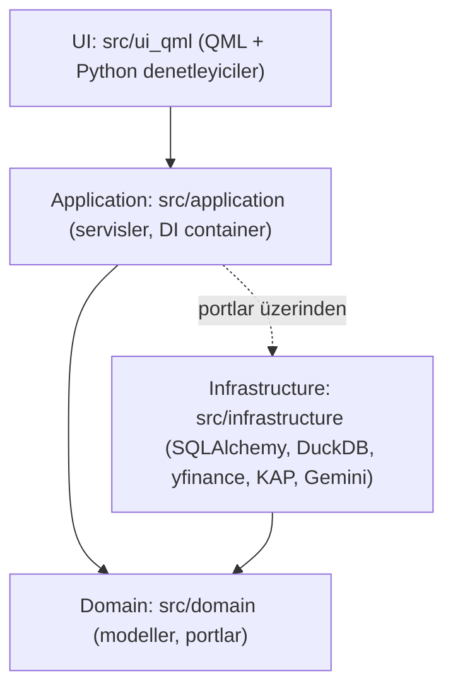
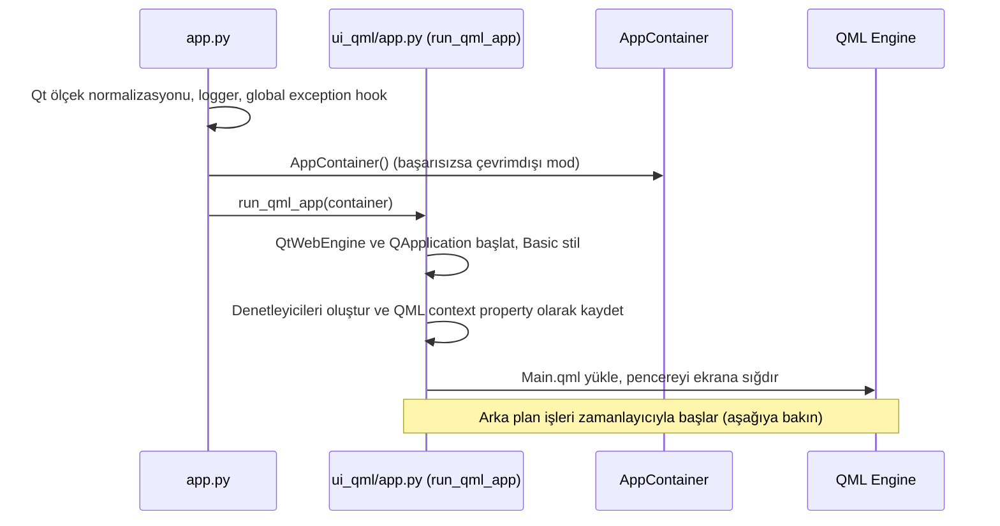

# Mimari Belgesi

> Ana sayfa: [index.md](index.md) | Değişiklik günlüğü: [log.md](log.md) | Kaynak ağacı: [project_structure.md](project_structure.md)

Portföy Simülasyonu, BIST ve küresel hisseleri takip eden bir **PySide6 + QML (Qt Quick)** masaüstü uygulamasıdır. Kod tabanı **Clean Architecture** ilkesine göre katmanlanmıştır: bağımlılıklar yalnızca içe doğru akar, iç katmanlar dış katmanları tanımaz.

| Katman | Dizin | Sorumluluk | Bağımlılık kuralı |
|---|---|---|---|
| Domain | `src/domain/` | Saf iş modelleri (`Portfolio`, `Position`, `Trade`, `CashMovement`, `CorporateAction`...) ve port arayüzleri (`I*Repository`, `I*Provider`). | Hiçbir dış paket veya katmana bağımlı değildir. |
| Application | `src/application/` | İş servisleri, DI container (`AppContainer`), `GlobalEventBus`. | Yalnızca domain ve portlara bağlıdır; somut altyapıyı container'da görür. |
| Infrastructure | `src/infrastructure/` | SQLAlchemy repository'leri, DuckDB deposu, yfinance/EVDS/KAP/İş Yatırım istemcileri, Gemini ve AI_Core sağlayıcıları, loglama. | Domain portlarını uygular. |
| UI | `src/ui_qml/` | QML görünümleri (`qml/`), Python denetleyiciler (`controllers/`), tablo modelleri (`models/`). | Yalnızca application ve domain'e bağlanır (aşağıya bakın). |

Yardımcı paketler: `config/` (ortam ayarları, güvenlik kalıpları), `src/qt_compat/` (Qt binding sınırı ve ekran ölçeği), `scripts/` (bakım ve göç betikleri).

---

## 1. Katman Kuralları ve Koruma Testleri

Kurallar testlerle kilitlenmiştir; ihlal eden değişiklik test kırar:

| Kural | Koruyan test |
|---|---|
| `src/ui_qml` içinde `src.infrastructure`, `sqlite3`, `duckdb`, `sqlalchemy` import edilmez; denetleyiciler repository'ye (`*_repo`) doğrudan erişmez. | `tests/ui_qml/test_architecture_guards.py` |
| Kullanıcıya görünen tüm QML metinleri `Strings.qml` içindedir; tanımsız/yinelenen/kullanılmayan anahtar ve QML'de sabit Türkçe literal yoktur. | `tests/ui_qml/test_strings_catalog.py` |
| Testlerde canlı ağ çağrısı yoktur; eski `src/ui` paketi geri gelmez; `app.py` `AA_ShareOpenGLContexts` ayarını `run_qml_app`'ten önce yapar. | `tests/test_repo_guards.py` |
| Kod boyutu eşikleri (sınıf, fonksiyon, karmaşıklık) ölçülür. | `scripts/measure_code_quality.py`, bkz. [code_quality_guardrails.md](code_quality_guardrails.md) |

Denetleyiciler veriyi application servislerinden okur. Tek okuma yüzeyleri: `StockLookupService` (hisse kaydı, fiyat serileri, DuckDB piyasa verisi), `DatabaseMaintenanceService` (veritabanı istatistiği, bütünlük, yedek), `MarketCorporateActionService` (piyasa düzeltmeleri).

---

## 2. Bağımlılık Enjeksiyonu (`AppContainer`)

`src/application/container.py` ince bir facade'dir. Sırasıyla dört fabrika kurar; her fabrikanın alanları container'a öznitelik olarak açılır (`container.price_repo`, `container.portfolio_service`...):

1. `build_repositories(conn_provider)` -> SQLAlchemy repository'leri ve DuckDB piyasa deposu (`container_parts/repositories.py`)
2. `build_market_clients(conn_provider)` -> yfinance istemcisi, fiyat lookup, benchmark ve değerleme sağlayıcıları, takvim (`market_clients.py`)
3. `build_services(...)` -> tüm application servisleri (`services.py`)
4. `build_ai(...)` -> yapay zeka servisleri (`ai.py`)

Ayarlar `config/settings_loader.py` içindeki `AppSettings` (veritabanı, AI, piyasa) ile merkezî okunur; ayrıntı için bkz. [development_guide.md](development_guide.md). Veritabanı bağlantısı `SQLAlchemyEngineProvider` ile kurulur ve ilk açılışta şemayı oluşturur ([database_schema_and_orm.md](database_schema_and_orm.md)).

Container kurulamazsa (ör. veritabanı yolu bozuk) `app.py` uyarı loglar ve arayüz çevrimdışı modda açılır.

---

## 3. Açılış Akışı

Açılıştan sonra başlayan otomatik işler (ayrıntı: [settings_and_system.md](settings_and_system.md)):

| Gecikme | İş | Denetleyici |
|---|---|---|
| 5 sn | Eksik gün farkı için DuckDB artımlı senkron (catch-up) | `MarketSyncController` |
| 6 sn | Otomatik canlı fiyat yenileme zamanlayıcısı (seans açıkken) | `SystemController` |
| 8 sn | Portföy/BIST kapanış tamamlama, KAP/MKK aday taraması, Golden Cross taraması | `StartupJobsController` |
| 18:30 (işlem günü; yarım gün 13:20) | Kapanış verisi hazır olunca artımlı senkron (seans kapanışı + 20 dk veri gecikmesi) | `MarketSyncController` |

---

## 4. Eşzamanlılık Modeli

- Ağ, veritabanı taraması ve ağır hesaplama ana (GUI) iş parçacığında çalıştırılmaz. Denetleyiciler `ThreadPoolExecutor` kullanır; sonuç, Qt kuyruklu sinyalleriyle (`_xxxFinished = Signal(...)`) ana iş parçacığına taşınır. Arka plan iş parçacığından QML özelliği değiştirilmez.
- Açılış işleri tek bir iş parçacığında sırayla çalışır (veri kaynaklarını aynı anda yormamak için).
- Etkileşimli `yfinance` çağrıları `yfinance_lock` kapısıyla serileştirilir; kapı 30 sn içinde alınamazsa uyarıp kilitsiz sürdürür (fail-open) ve kilit yeniden deneme beklemesi sırasında tutulmaz ([service_market_data_providers.md](service_market_data_providers.md)).
- Fiyat güncellemeleri `GlobalEventBus.prices_updated` (Qt sinyali, yük: `dict[int, Decimal]`) ile yayınlanır; Dashboard ve Model Portföy bu sinyali dinleyerek yenilenir.

---

## 5. Veri Mimarisi Özeti

Uygulama iki yerel dosya veritabanı kullanır; harici sunucu gerekmez:

| Depo | Dosya | İçerik |
|---|---|---|
| SQLite (OLTP) | `data/portfolio.db` | Portföy işlemleri, nakit hareketleri, izleme listeleri, model portföyler, bütçe/hedefler, kurumsal aksiyonlar, risk profilleri, KAP önbelleği, portföy hisselerinin kapanışları |
| DuckDB (OLAP) | `data/market_history.duckdb` | Tüm BIST günlük ham barları (~624 hisse, 2000'den bugüne) ve sermaye artırımı düzeltme faktörleri |

Sahiplik kuralları, ticker biçimi ve bilinen sınırlar: [data_architecture.md](data_architecture.md). Şema: [database_schema_and_orm.md](database_schema_and_orm.md).

---

## 6. Temel Tasarım Kararları (neden)

| Karar | Gerekçe |
|---|---|
| **Portföy olay kaynaklıdır**: türev değerler (K/Z, maliyet, lot) saklanmaz, `Portfolio.from_trades()` ile işlem geçmişinden yeniden hesaplanır. | Geçmişe dönük işlem, bedelsiz veya düzeltme tek doğruluk kaynağından tutarlı kalır ([service_portfolio_and_market.md](service_portfolio_and_market.md)). |
| **Parasal hesaplar `Decimal`** ile yapılır. | Kayan nokta yuvarlama hataları para değerlerine sızmaz. |
| **Ham fiyat barları değişmez**; sermaye artırımı düzeltmesi okuma anında faktörle uygulanır. | Geri alınabilir, yeniden indirmeye dayanıklı, denetlenebilir ([market_corporate_actions.md](market_corporate_actions.md)). |
| **Kanonik ticker uzantısızdır** (`THYAO`); `.IS` yalnızca yfinance sınırında eklenir. | Tek biçim, aramada tutarsızlığı önler (`src/domain/ticker.py`). |
| **Temettü getiridir, sermaye girişi değildir** (`CashMovementType.DIVIDEND`). | Zaman ağırlıklı getiri temettüyü yansıtır ([service_corporate_actions.md](service_corporate_actions.md)). |
| **Yapay zekâ araçları salt okunurdur.** | Emir/para hareketi LLM'e bırakılmaz ([ai_integration.md](ai_integration.md)). |
| **Teknik göstergeler ve risk metrikleri özel NumPy/Pandas kodudur**, `pandas-ta`/`quantstats` kullanılmaz. | Bakımsız ve sürüm kırılgan bağımlılıklardan kaçınmak ([technical_analysis_and_screener.md](technical_analysis_and_screener.md)). |
| **Arayüz yalnızca QML'dir** (eski Qt Widgets arayüzü 2026-10-03'te silindi). | GPU hızlandırmalı, akıcı arayüz ve temiz Python/QML ayrımı ([ui_architecture_and_events.md](ui_architecture_and_events.md)). |
| **SQLite `BIGINT` birincil anahtarlara `before_insert` dinleyicisi `max(id)+1` atar.** | SQLite `BIGINT` anahtarı otomatik artırmaz. |

---

## 7. Belge Haritası

| Alan | Sayfa |
|---|---|
| Geliştirme ortamı, komutlar, ayarlar | [development_guide.md](development_guide.md) |
| Kaynak ağacı ve modül haritası | [project_structure.md](project_structure.md) |
| Arayüz mimarisi ve QML kuralları | [ui_architecture_and_events.md](ui_architecture_and_events.md) |
| 10 sayfa ve denetleyici rehberi | [qml_pages_guide.md](qml_pages_guide.md) |
| Portföy, fiyat akışları, nakit | [service_portfolio_and_market.md](service_portfolio_and_market.md) |
| Piyasa veri kaynakları ve yeniden deneme | [service_market_data_providers.md](service_market_data_providers.md) |
| Kurumsal aksiyonlar ve temettü | [service_corporate_actions.md](service_corporate_actions.md), [market_corporate_actions.md](market_corporate_actions.md) |
| Analiz, risk metrikleri, karşılaştırma | [service_analysis.md](service_analysis.md), [comparison_lab.md](comparison_lab.md) |
| Teknik analiz ve tarayıcı | [technical_analysis_and_screener.md](technical_analysis_and_screener.md) |
| Hisse 360 | [stock_360.md](stock_360.md) |
| Planlama, optimizasyon, risk profili, model portföy | [service_planning_optimization.md](service_planning_optimization.md) |
| Tarihsel simülasyon ve backtest | [service_simulation.md](service_simulation.md) |
| İzleme listesi | [service_watchlist.md](service_watchlist.md) |
| Raporlama | [service_reporting_and_export.md](service_reporting_and_export.md) |
| Yapay zekâ | [ai_integration.md](ai_integration.md) |
| Ayarlar ve sistem | [settings_and_system.md](settings_and_system.md) |
| Veritabanı, bakım | [database_schema_and_orm.md](database_schema_and_orm.md), [database_maintenance_and_scripts.md](database_maintenance_and_scripts.md) |
| Test, kalite, derleme | [testing_strategy.md](testing_strategy.md), [manual_testing_guide.md](manual_testing_guide.md), [code_quality_guardrails.md](code_quality_guardrails.md), [project_build_and_deployment.md](project_build_and_deployment.md) |
| Terimler | [glossary.md](glossary.md) |
| Yapılacaklar | [roadmap.md](roadmap.md) |
